<picture>
  <source media="(prefers-color-scheme: dark)" srcset="assets/hive-header-dark.svg">
  <source media="(prefers-color-scheme: light)" srcset="assets/hive-header-light.svg">
  
</picture>

Head of AI at [ExpertGroup](https://expertgroup.rs), where my team and I build RAG and document intelligence,
agentic applications and cloud data platforms. Before software I spent a decade in biomedical research,
and I still publish in computational cardiology.

###  What I'm building

- [**claude-role-skills**](https://github.com/ManSe404/claude-role-skills): Claude Code skills by role. 10 packs and 50 skills for engineers, architects, data people and analysts. Each skill counts with scripts and ends in a page you can share. MIT
- [**Mosaic**](https://manse404.github.io/webpage/projects/mosaic/): composable document-AI bricks. The pipeline and the question are both plans written as data, and every brick has to beat a BM25 baseline before it stays
- [**Mission Control**](https://manse404.github.io/webpage/projects/mission-control/): a local dashboard for long Claude Code runs, where "done" is decided by checks that run outside the session
- [**co-parenting-app**](https://github.com/ManSe404/co-parenting-app): a shared space for two separated parents, with a calendar, agreements and documents. Anything that concerns both parents needs the other's consent, and the database enforces it. MIT
- [**car_scraper**](https://github.com/ManSe404/car_scraper): Car Watch flags used-car ads priced below what similar cars cost, using a gradient-boosting fair-price model

[All case studies →](https://manse404.github.io/webpage/projects/)

###  Research

14 peer-reviewed works · 138 citations · h-index 5

- [Sacubitril/valsartan for non-obstructive HCM: the SILICOFCM trial](https://doi.org/10.1002/ejhf.3291) (2024), *European Journal of Heart Failure*
- [Ventilatory efficiency parameters in HCM](https://doi.org/10.1016/j.pcad.2024.10.005) (2024), first author
- [A machine learning approach to gene expression in HCM](https://doi.org/10.3390/ph17101364) (2024)

[Research profile →](https://manse404.github.io/webpage/research/) · [Google Scholar →](https://scholar.google.com/citations?user=HlXUn7wAAAAJ&hl=en)

###  Stack

###  Connect

